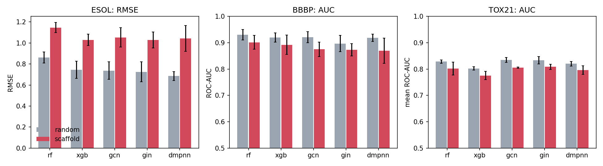

# Do graph neural networks beat fingerprint baselines on small molecular datasets? A scaffold-split benchmark with calibration checks

## Abstract

We compare three plain-PyTorch graph neural networks (GCN, GINE, D-MPNN), each as a single model and as a 3-member ensemble, against random forest and XGBoost on ECFP counts. The datasets are MoleculeNet ESOL, BBBP and Tox21, evaluated under random and Bemis-Murcko scaffold splits over 3 to 5 split seeds, without hyperparameter tuning. Differences between GNNs and fingerprint baselines are mostly smaller than split-to-split variation. On the scaffold split the best ESOL model (gin-ens3, RMSE 0.973 ± 0.087) is within one standard deviation of XGBoost (1.029 ± 0.053), random forest is best on BBBP (AUC 0.901 ± 0.026), and GNN ensembles are slightly ahead on Tox21 (0.821 ± 0.006 vs 0.802 ± 0.025). Scaffold splitting costs all model families a similar amount. GNN ensemble spread gives poor uncertainty on out-of-scaffold molecules: nominal 90% intervals on ESOL cover the truth 25% to 38% of the time.



## 1. Question

Do GNNs outperform fingerprint baselines on small molecular property datasets when the split and the uncertainty estimate are handled carefully? Two sub-questions: how much of reported performance depends on the split type, and are ensemble-based uncertainty estimates trustworthy on molecules from unseen scaffolds?

## 2. Methods

**Data.** ESOL (regression, RMSE), BBBP (binary, ROC-AUC) and Tox21 (12 tasks with missing labels, mean masked ROC-AUC). Molecules RDKit cannot parse are dropped so every model sees the same rows.

**Splits.** A random 80/10/10 split and a balanced Bemis-Murcko scaffold split in which whole scaffolds go to one side. 5 split seeds for ESOL and BBBP, 3 for Tox21. A unit test checks that no scaffold crosses the scaffold split.

**Models.**
- Baselines: random forest and XGBoost on ECFP counts.
- GNNs: GCN, GINE and D-MPNN written in plain PyTorch (no PyG), trained with early stopping on a validation set (60 epochs, patience 12) and masked multi-task losses for Tox21. Each GNN is also run as a 3-member seed ensemble (`-ens3`).
- No hyperparameter tuning for any model. Settings were fixed in advance.

**Uncertainty.** For ESOL, the interval is mean ± 1.645 sigma, with sigma the spread across ensemble members (GNNs) or across trees (random forest); nominal coverage is 90%. For classification, expected calibration error (ECE) is reported.

## 3. Results

Mean ± std over split seeds, scaffold split. Full tables, including random-split numbers, are in [`results/summary.md`](results/summary.md).

| model | ESOL RMSE ↓ | BBBP AUC ↑ | Tox21 AUC ↑ |
|---|---|---|---|
| rf | 1.147 ± 0.047 | **0.901 ± 0.026** | 0.802 ± 0.025 |
| xgb | 1.029 ± 0.053 | 0.892 ± 0.037 | 0.775 ± 0.015 |
| gcn | 1.053 ± 0.092 | 0.875 ± 0.027 | 0.806 ± 0.002 |
| gin | 1.028 ± 0.075 | 0.873 ± 0.024 | 0.808 ± 0.010 |
| dmpnn | 1.044 ± 0.124 | 0.870 ± 0.048 | 0.796 ± 0.016 |
| gcn-ens3 | 1.012 ± 0.108 | 0.883 ± 0.024 | 0.814 ± 0.006 |
| gin-ens3 | **0.973 ± 0.087** | 0.869 ± 0.024 | **0.821 ± 0.006** |
| dmpnn-ens3 | 0.998 ± 0.121 | 0.875 ± 0.041 | 0.803 ± 0.014 |

**Split leakage.** Under a random split, the share of test molecules whose scaffold also appears in training is 58% (BBBP), 77% (Tox21) and 81% (ESOL), versus 0% under the scaffold split by construction. Moving to the scaffold split raises ESOL RMSE by about 0.28 to 0.36 for every model and lowers classification AUC by about 0.02 to 0.05.

**Interval coverage (ESOL, scaffold split, nominal 90%).** Random forest 0.91 ± 0.03; gcn-ens3 0.32 ± 0.07; gin-ens3 0.38 ± 0.07; dmpnn-ens3 0.25 ± 0.09.

**Classification calibration (ECE, scaffold split).** On Tox21, ECE is about 0.01 to 0.02 for every model except XGBoost (0.115). On BBBP it is about 0.07 to 0.10; random forest (0.071) and XGBoost (0.073) are slightly better calibrated than the GNNs (0.080 to 0.102).

## 4. Discussion

1. **No clear GNN advantage.** On ESOL, gin-ens3 (0.973) is within one standard deviation of XGBoost (1.029). On BBBP the random forest is best and every GNN is about 0.02 to 0.03 AUC behind it. Only on Tox21 do GNNs sit slightly above the baselines, with 3 seeds and std up to 0.025.
2. **Ensembling usually helps a little.** An `-ens3` model beats its single-model version in most cells (ESOL scaffold RMSE improves by 0.04 to 0.055) but not all: on BBBP scaffold, gin-ens3 is slightly worse than gin (0.869 vs 0.873). The gains are comparable to the noise.
3. **Random splits flatter every model.** The scaffold penalty is similar across model families, so these data do not show that GNNs are more or less hurt by scaffold shift than fingerprints.
4. **Ensemble spread is overconfident here.** The GNN ensembles cover 25% to 38% against a nominal 90%, while the random forest, which has the worst RMSE of the group, covers 91%. With only 3 members the ensembles are overconfident; recalibration was not tried.

## 5. Limitations

- Few seeds (5 for ESOL and BBBP, 3 for Tox21). Most gaps between models lie inside one standard deviation and should be read as no detectable difference.
- No tuning for any model and a short training schedule (60 epochs, patience 12). Tuned or pretrained GNNs, or larger ensembles, could change the ranking.
- Ensembles have 3 members, which probably contributes to the low interval coverage.
- The interval check is ESOL only; classification uncertainty is assessed through ECE alone.
- Scaffold splits are one kind of distribution shift. An error-versus-similarity analysis (error as a function of distance to the nearest training molecule) was not done.
- Three datasets of modest size say nothing about large or 3D-dependent benchmarks.

## 6. Reproduce

```bash
conda env create -f environment.yml && conda activate bioml
export PYTHONPATH=src
python scripts/run_baselines.py        # RF / XGBoost
python scripts/run_gnns.py             # GCN / GINE / D-MPNN and ensembles (resumable)
python scripts/make_report.py          # tables and figure
pytest
```
